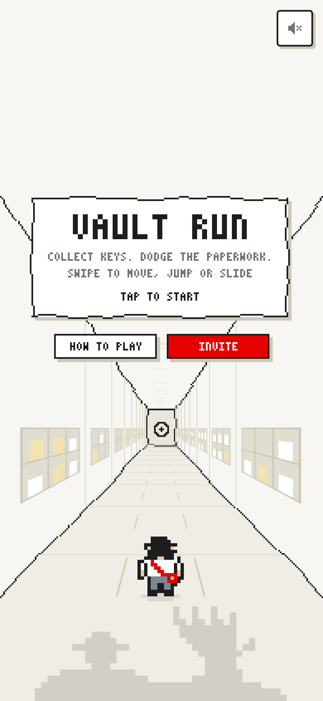
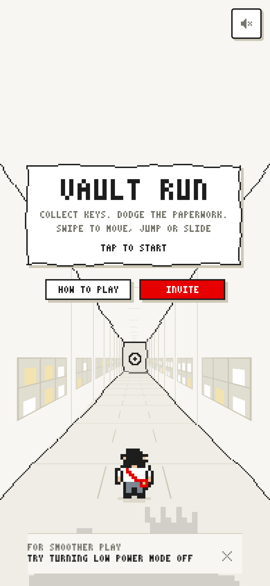
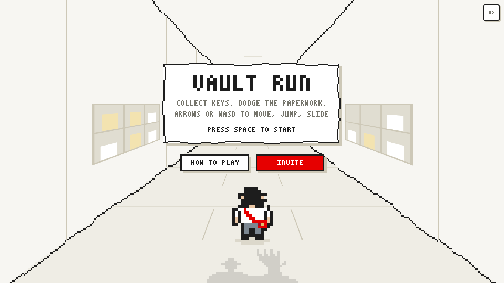
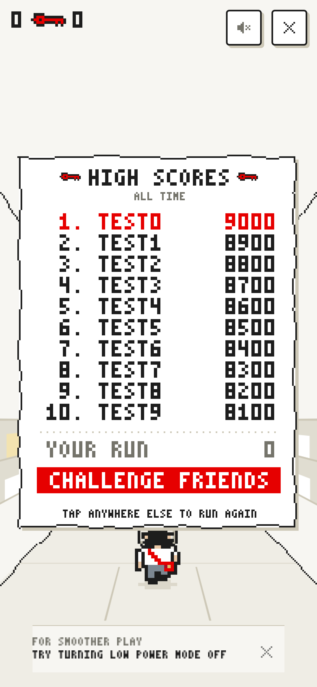

# iPhone frame-cap hint review

A suggested Low Power Mode check, not a claim that the setting was detected.

- Requires an iPhone user agent and a focused, visible page.
- Discards the first 1.5 seconds after a timing-context change, then checks four seconds of raw animation-frame intervals.
- Requires at least 100 samples, at least 90% between 28 and 38 ms, and an average between 31 and 35 ms on the lightweight title/results screen. Slow gameplay alone never establishes the hint.
- Faster frames clear the hint. Backgrounding, focus loss, and long stalls clear stale evidence; returning requires fresh measurement. Dismissal lasts until the page reloads.
- Visible only on title/results screens with enough portrait space (at least 720 CSS pixels high). Hidden during gameplay, the server room, pause, help, initials entry, and short/landscape layouts.
- Uses the game's pixel font, paper/ink/muted palette, a hairline divider, and a 44-pixel dismiss target. It does not block starting or retrying.
- No battery access, new analytics, dependencies, or gameplay/scoring changes.

## Browser-rendered evidence

These images render the actual game at 390 x 844 @ 3x and 1366 x 768. The test uses an iPhone user agent and controlled RAF timestamps in Chromium. It does **not** emulate the iOS battery setting or certify behavior on physical Safari. The results board contains synthetic test scores.

| Before | After |
| --- | --- |
|  |  |
|  |  |



## Reproduce

```sh
npm ci
npx playwright install chromium
npm test
CAP_SCREENSHOTS=docs/previews/frame-cap node tests/frame-cap-browser.mjs
```

To capture the baseline, export the base commit's `public/game.js` to a temporary file and pass its absolute path as `BASELINE_GAME` alongside `CAP_SCREENSHOTS`.

## Physical iPhone check before deployment

1. Open the game in Safari with Low Power Mode off. Wait on the title screen; normal 60/120 FPS should not prompt.
2. Enable Low Power Mode in Settings, return, and wait about six seconds. A steady 30 FPS cap should prompt if the viewport has room.
3. Start a run; the notice must disappear. Return to the title or results screen to view it again.
4. Turn Low Power Mode off, return, and confirm the notice disappears and stays gone at the restored frame rate.
5. Dismiss with the small x and confirm it does not start a run or return during this page visit.

Claude review/approval is required before merge or deployment.
